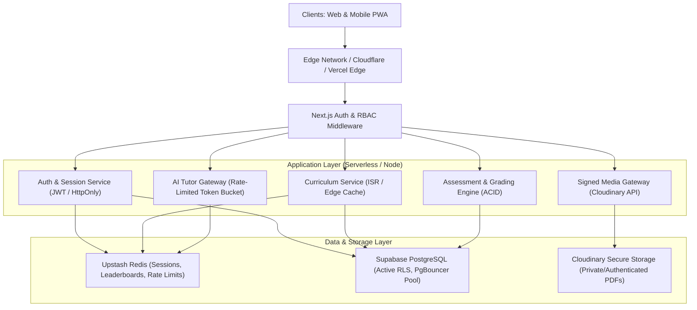
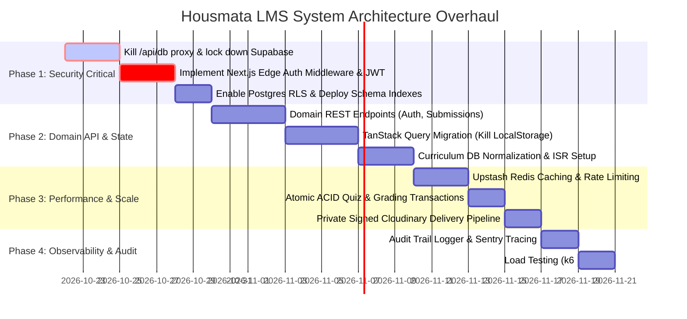

# Housmata LMS — System Design Evaluation, Forensic Audit & Architecture Upgrade Plan
## Orchestrated via the System Design Engineering Methodology

---

## 1. Executive Summary & Forensic Audit of Current State

A rigorous architectural inspection of the `housmatalms-main` codebase reveals a system operating with severe structural, security, and scalability bottlenecks. While functional for a prototype cohort, the current implementation presents **critical vulnerabilities and scalability ceilings** that must be resolved before expanding to multi-cohort enterprise scale.

```
CURRENT VULNERABLE ARCHITECTURE:
┌─────────────────┐       GET/POST/DELETE (No Session/Auth Header)       ┌────────────────────────┐
│  Browser Client ├────────────────────────────────────────────────────►│  /api/db/[table]        │
│                 │                                                      │  (Next.js Server Proxy)│
│  localStorage:  │◄────────────────────────────────────────────────────┤                        │
│  Full DB Dump   │   Dumps entire DB tables into browser storage        │  Holds:                │
│  (14 tables)    │                                                      │  SERVICE_ROLE_KEY      │
└────────┬────────┘                                                      └───────────┬────────────┘
         │                                                                           │
         │ Spoofable Auth                                                            │ Unrestricted
         ▼                                                                           ▼ Superuser SQL
┌──────────────────────────────┐                                         ┌────────────────────────┐
│ localStorage["lms_current_   │                                         │  Supabase Postgres     │
│ user_id"] = "<admin_uuid>"   │                                         │  (RLS Completely       │
│ ==> INSTANT ADMIN ACCESS     │                                         │   Bypassed)            │
└──────────────────────────────┘                                         └────────────────────────┘
```

### 1.1 Critical Architectural & Security Findings

| Vulnerability / Bottleneck | Location in Codebase | Severity | Impact |
|---|---|---|---|
| **Public Superuser DB Proxy** | `src/app/api/db/[table]/route.ts` | **CRITICAL (CVSS 10.0)** | Route proxies arbitrary `GET`, `POST`, `DELETE` queries to 15 core tables using `SUPABASE_SERVICE_ROLE_KEY`. **No session check, no token verification, no user validation**. Any external actor can wipe or dump the entire database via a simple HTTP request. |
| **Client-Side Auth Spoofing** | `src/lib/useAuth.ts` | **CRITICAL (CVSS 9.8)** | Authentication consists solely of `localStorage.getItem("lms_current_user_id")`. Any user can open Chrome DevTools, set an admin's ID, and immediately execute administrative actions. Zero cryptographic authentication or password verification. |
| **Entire Database Hydrated into `localStorage`** | `src/lib/db.ts` (`syncFromSupabase()`) | **HIGH** | On application boot, the client downloads entire tables (`profiles`, `submissions`, `quiz_attempts`, `attendance`, `cohorts`, `applications`, `surveys`) and writes them into `localStorage`. Violates privacy (students download other students' grades) and risks `QuotaExceededError` (5MB browser limit). |
| **509 KB Hardcoded Curriculum Monolith** | `src/lib/curriculum.ts` | **MEDIUM** | Over 500 KB of static TypeScript text bundled directly into the client JavaScript bundle. Bloats initial bundle size, increases Time-to-Interactive on mobile devices in Africa, and requires a full redeployment to edit any lesson typo. |
| **No Transactional Integrity on Assessments** | `src/lib/db.ts` (`submitQuiz()`, `gradeSubmission()`) | **HIGH** | Double submissions, score updates, and point calculations execute via non-transactional, optimistic local state mutations followed by best-effort asynchronous API writes. Susceptible to race conditions, double points, and desynchronization. |
| **Lack of Edge Rate Limiting & Abuse Defense** | `/api/ai`, `/api/upload`, `/api/db` | **HIGH** | No rate limiting on AI tutoring endpoints (consuming LLM tokens) or sign-upload endpoints (risking storage spam and resource exhaustion). |

---

## 2. Requirements & Scale Estimation (Back-of-the-Envelope)

### 2.1 Scope & Functional Requirements
- **Core Entities**: Candidates, Students, Instructors, Admins, Cohorts, Modules, Lessons, Quizzes, Submissions, Grades, Certificates, Attendance, Surveys, Announcements.
- **Critical Workflows**:
  - Secure Authentication & Role-Based Access Control (RBAC).
  - High-concurrency live session attendance verification.
  - Streaming lesson delivery with AI assistant tutoring.
  - PDF/Media assignment submission with virus-scan and tamper-proof storage.
  - Strict grading rubrics with tamper-proof certificate generation.

### 2.2 Scale & Capacity Planning (5-Year Target)
- **Active Students**: 5,000 concurrent learners across 25 cohorts.
- **Instructors & Evaluators**: 100 active reviewers.
- **Read/Write Profile**: Heavily read-skewed (**95% reads, 5% writes**).
  - Reads: Lesson viewing, module directories, leaderboard polling, grade checks.
  - Writes: Attendance check-ins, quiz submissions, assignment uploads, grading feedback.
- **QPS (Queries Per Second)**:
  - Average Daily Active Users (DAU): ~2,500 students.
  - Average Requests per user session: 60 requests / hour.
  - Daily request volume: $2,500 \times 60 = 150,000$ requests / peak 4-hour evening window.
  - Peak QPS: $\frac{150,000}{4 \times 3600} \approx 10.4\text{ QPS}$ (standard), burst peak during live session attendance: **~150 QPS**.
- **Storage Projections**:
  - Curriculum text: ~5 MB total.
  - Student submissions: 5,000 students $\times$ 10 modules $\times$ 2 MB average PDF $= 100\text{ GB}$.
  - Database metadata: 5,000 profiles $+$ 50,000 submissions $+$ 100,000 quiz attempts $\approx 150\text{ MB}$ structured SQL storage.

---

## 3. Target Architecture: Modern Scalable LMS



---

## 4. Architectural Building Blocks & Upgrade Plans

### Block 1: Security, Authentication & Session Hardening (`api-design` & `service-decomposition`)

#### Current Flaw
`useAuth.ts` relies on unverified `localStorage.getItem("lms_current_user_id")` and client-side passwordless email lookups. Any user can escalate privileges to `admin` in seconds.

#### Target Redesign
1. **Cryptographic Authentication**:
   - Migrate to **Supabase Auth** or **NextAuth v5 / Lucia** with encrypted session cookies (`__Host-Session`, `HttpOnly`, `Secure`, `SameSite=Lax`).
   - Implement Passwordless Email Magic Links / TOTP with signed HMAC tokens (15-minute expiry).
2. **Server-Side RBAC Middleware (`src/middleware.ts`)**:
   - Intercept every `/lms/*` request at the Edge before rendering.
   - Decrypt and verify JWT signature using server secret.
   - Enforce route boundaries:
     - `/lms/admin/*` $\rightarrow$ requires `role: "admin"` in validated claims.
     - `/lms/instructor/*` $\rightarrow$ requires `role: "instructor" | "admin"`.
     - `/lms/student/*` $\rightarrow$ requires `role: "student" | "admin"`.
   - Unauthorized attempts immediately redirect to `/lms/login` with `401 Unauthorized` audit events logged.
3. **Branded Notification Security (`emailTemplate.ts`)**:
   - Replace insecure plaintext profile ID tokens (`/lms/login?token=${profile.id}`) with cryptographically signed, expiring HMAC magic links (`/api/v1/auth/magic-link?sig=...`).
   - Strictly preserve Housmata's official HTML email layout, brand header, and signature **Housmata Emerald (`#02b875`)** action buttons across all student admissions, grade releases, and announcement emails.

---

### Block 2: Complete Deprecation & Replacement of `/api/db/[table]`

#### Current Flaw
The route `/api/db/[table]/route.ts` acts as an unrestricted open proxy to Supabase Postgres using the `SERVICE_ROLE_KEY`.

#### Target Redesign
1. **Immediate Deletion**:
   - Delete `/api/db/[table]/route.ts` and eliminate all client-side calls to `apiSelect`, `apiWrite`, and `apiDeleteEq`.
2. **Domain-Driven REST & Server Actions**:
   - Create strictly typed, authenticated domain endpoints:
     - `POST /api/v1/auth/login` & `POST /api/v1/auth/logout`
     - `GET /api/v1/curriculum/modules` & `GET /api/v1/curriculum/lessons/[id]`
     - `POST /api/v1/submissions` (Body validated with **Zod**, extracts user ID from authenticated session, rejects mismatched user IDs)
     - `PATCH /api/v1/submissions/[id]/grade` (Guarded: instructor/admin only)
     - `POST /api/v1/quizzes/[id]/attempt` (Server-side question delivery and answer evaluation — never leak correct answers to the client)
     - `POST /api/v1/attendance/check-in` (Validates 60-second rotating TOTP / QR code)
3. **Row-Level Security (RLS) Enforcement**:
   - Re-enable PostgreSQL RLS on all 15 tables.
   - Students can only `SELECT` and `INSERT` rows matching their own `auth.uid()`.
   - Instructors can `SELECT` and `UPDATE` submissions belonging to their assigned cohort.
   - Admins retain global CRUD access via explicit security policies.

---

### Block 3: Database Modernization & Client State Decoupling (`data-storage`)

#### Current Flaw
`LocalStorageDB` pulls down 14 database tables into the browser, mirroring all records in `localStorage`. This creates massive network egress, risks data leakage, and hits the 5MB browser storage ceiling.

#### Target Redesign
1. **Eliminate Client-Side Database Mirror**:
   - Completely remove `LocalStorageDB` and `localStorage["lms_*"]` caches.
   - Adopt **TanStack Query (React Query v5)** for client-side asynchronous data fetching, pagination, background refetching, and stale-while-revalidate caching.
2. **Postgres Indexing & Schema Optimization**:
   - Execute database migration script (`supabase/migrations/20261021_schema_hardening.sql`):
     ```sql
     -- B-Tree Indexes for High-Frequency Join and Filter Columns
     CREATE INDEX idx_submissions_user_assignment ON submissions (user_id, assignment_id);
     CREATE INDEX idx_submissions_status ON submissions (status) WHERE status = 'submitted';
     CREATE INDEX idx_quiz_attempts_user ON quiz_attempts (user_id, quiz_id);
     CREATE INDEX idx_cohort_members_cohort_user ON cohort_members (cohort_id, user_id);
     CREATE INDEX idx_attendance_cohort_session ON attendance (cohort_id, session_date);
     CREATE INDEX idx_profiles_role ON profiles (role);
     ```
3. **Database Connection Pooling**:
   - Route Next.js server actions and API handlers through **PgBouncer** / Supabase Transaction Pool (port 6543) to prevent connection exhaustion during concurrent traffic spikes.

---

### Block 4: Decoupling the 500 KB Curriculum Monolith (`content-delivery` & `blob-store`)

#### Current Flaw
`src/lib/curriculum.ts` is a 509 KB hardcoded file bundled into the client runtime.

#### Target Redesign
1. **Curriculum as Data (CMS / Postgres)**:
   - Normalize modules and lessons into structured relational tables:
     - `modules` (`id`, `course_id`, `sequence_order`, `title`, `objective`)
     - `lessons` (`id`, `module_id`, `sequence_order`, `title`, `content_markdown`, `estimated_minutes`)
     - `assignments` (`id`, `module_id`, `title`, `rubric_json`, `max_score`)
2. **Edge Caching via Next.js Incremental Static Regeneration (ISR)**:
   - Serve `/curriculum` and `/curriculum/[moduleId]` using Next.js ISR with a `revalidate: 3600` (1-hour) window.
   - When an instructor updates lesson content, invoke `revalidatePath('/curriculum/[moduleId]')` to instantaneously purge Edge CDN caches without redeploying code.

---

### Block 5: Caching, Real-Time Leaderboards & Rate Limiting (`caching` & `sharded-counters`)

#### Target Redesign
1. **Upstash Redis Integration**:
   - Deploy a serverless Redis instance for:
     - **Session Cache**: Sub-millisecond JWT blacklist and session verification.
     - **Rate Limiting**: Sliding-window token bucket algorithm protecting `/api/ai` (max 10 requests / min per student) and `/api/auth` (max 5 failed login attempts / 15 min).
     - **Real-Time Leaderboard**: Utilize Redis Sorted Sets (`ZADD`, `ZREVRANGE`, `ZREVRANK`) to calculate student rankings across cohorts with $O(\log N)$ time complexity, eliminating heavy `COUNT()` and `SUM()` SQL scans across the entire submissions table.

---

### Block 6: Transactional Integrity on Assessments & Grading (`consistency-coordination`)

#### Current Flaw
Submissions and quiz attempts mutate locally and sync asynchronously without transactional locks, allowing students to resubmit simultaneously and receive duplicate point allocations.

#### Target Redesign
1. **PostgreSQL Atomic Transactions**:
   - Wrap quiz completions and assignment submissions in stored procedures or ACID database transactions:
     ```sql
     BEGIN;
     -- Check if already passed or maximum attempts exceeded
     SELECT COUNT(*) FROM quiz_attempts WHERE user_id = $1 AND quiz_id = $2 AND passed = true FOR UPDATE;
     
     -- Insert attempt
     INSERT INTO quiz_attempts (id, user_id, quiz_id, score, passed, submitted_at)
     VALUES ($3, $1, $2, $4, $5, NOW());

     -- Conditionally update overall student points
     UPDATE student_progress
     SET total_points = total_points + $4,
         completed_lessons = completed_lessons + 1
     WHERE user_id = $1;
     COMMIT;
     ```

---

### Block 7: Media Pipeline & PDF Delivery Hardening (`blob-store`)

#### Current State & Enhancements
The recent Cloudinary migration resolved direct server file proxying. However, submission PDFs currently rely on insecure signed direct URLs that could be shared publicly.

#### Target Redesign
1. **Private / Authenticated Cloudinary Deliveries**:
   - Store student submissions with `type: "authenticated"` or `access_mode: "authenticated"`.
   - Generate short-lived signed URLs (valid for 10 minutes) when an instructor opens the submission reader:
     `GET /api/v1/submissions/[id]/preview-url` $\rightarrow$ verifies reviewer authorization, signs Cloudinary URL, and returns expiring redirect.
2. **Inline Mobile Preview Optimization**:
   - Maintain the multi-page JPEG transform (`pg_N,f_jpg`) for low-bandwidth mobile browsers that fail to render native PDF embed tags.

---

### Block 8: Observability, Audit Logging & Failure Modes (`observability` & `resilience-failure`)

```
┌────────────────────────────────────────────────────────────────────────┐
│                        OBSERVABILITY PIPELINE                          │
├───────────────────┬────────────────────────────────┬───────────────────┤
│ Structured Logs   │ Application Metrics            │ Audit Trail Table │
│ (Pino / OpenTel)  │ (Sentry Tracing / Vercel Mon)  │ (Postgres Append) │
│ • Correlation IDs │ • API Route Latency (p95, p99) │ • Grade changes   │
│ • User Context    │ • AI Token Consumed            │ • Role elevations │
│ • HTTP Error 5xx  │ • Cloudinary Failure Rates     │ • User deletions  │
└───────────────────┴────────────────────────────────┴───────────────────┘
```

1. **Structured Logging (`src/lib/logger.ts`)**:
   - Integrate Pino logger with correlation IDs (`x-request-id`) injected by Edge middleware.
2. **Immutable Administrative Audit Trail (`audit_logs`)**:
   - Create an append-only audit table in Postgres to track:
     - `timestamp`, `actor_user_id`, `target_user_id`, `action` ("GRADE_OVERRIDE", "ROLE_CHANGE", "APPLICATION_APPROVED"), `previous_state`, `new_state`, `ip_address`.
3. **Resilience & Circuit Breakers**:
   - Implement circuit breakers for external third-party dependencies:
     - **Resend (Email)**: If Resend API experiences a degraded outage, queue email notifications into an asynchronous Postgres table (`email_outbox`) and retry with exponential backoff.
     - **Gemini / OpenAI (AI Tutor)**: Graceful fallback message with status indicator when AI service is unavailable.

---

## 5. Trade-Off Analysis Matrix

| Design Decision | What it Solves (Benefits) | What it Worsens (Costs) | When to Change / Re-evaluate |
|---|---|---|---|
| **Deprecate `/api/db/[table]` in favor of Domain REST** | Closes critical CVSS 10.0 superuser hole; enforces RBAC, schema validation, and RLS. | Increases initial code boilerplate; requires explicit route handlers per feature. | Never revert. This is mandatory for any production system. |
| **TanStack Query instead of `localStorage` sync** | Prevents 5MB storage limit crashes; eliminates client data leaks; ensures instant fresh data. | Requires network connectivity for fresh uncached reads; introduces query caching invalidation logic. | If full offline-first offline PWA mode is required (would use IndexedDB with local encryption). |
| **Move Curriculum to Postgres + ISR** | Allows dynamic curriculum editing by instructors without code rebuilds; reduces bundle size by 500 KB. | Introduces database dependency for content; requires revalidation webhook triggers. | If course authoring moves to an external headless CMS (e.g. Sanity or Strapi). |
| **Redis for Leaderboards & Rate Limiting** | $O(\log N)$ real-time rank queries; sub-millisecond rate-limit checks; shields Postgres from lock contention. | Adds an additional external infrastructure component (Upstash Redis) and minor operational cost. | If active concurrent students remain under 200 (Postgres indexed queries suffice at micro-scale). |

---

## 6. Implementation Roadmap & Execution Phases



### Immediate Sprint Action Items (Next 72 Hours)
1. **Patch `/api/db/[table]`**: Introduce an interim authorization gate verifying session JWT before forwarding any queries, or restrict to non-destructive operations.
2. **Session Signature**: Transition `useAuth.ts` from plain `localStorage` reading to a signed cookie validated via Next.js middleware.
3. **Run Indexing Script**: Execute the B-Tree index migration on Supabase to optimize slow student submission and quiz queries.
