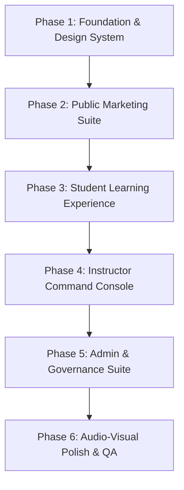

# Housmata LMS — Complete UI/UX Overhaul Master Plan
## Architecture: HashiCorp Design Principles + Lenis + GSAP + React Bits

---

## 1. Executive Summary & Design Vision

Housmata LMS is transitioning from a utilitarian light/dark web template into an **engineered, operator-grade enterprise learning platform**. Inspired by HashiCorp's foundational design system, the new interface treats the screen as an enterprise-infrastructure marketing canvas and high-focus command console **while strictly preserving and elevating Housmata's core brand identity, signature emerald color palette, and authoritative institutional positioning**.

Rather than relying on generic shadows, bubbly cards, and decorative gradients, the overhauled interface employs:
1. **A pure black canvas (`#000000`) with precise charcoal surface lifts** (`#15181e`, `#1f232b`, `#3b3d45`) and 1px translucent hairlines (`rgba(178, 182, 189, 0.1)`).
2. **Strict Brand Preservation & Chromatic Identity Token System**:
   - **Canonical Brand Primary (Housmata Emerald `#02b875` / `#00ca8e`)**: The bedrock of Housmata's identity across the web and mobile. Represents land asset custodianship, growth, verified trust, and digital real estate infrastructure in Africa. Anchors global logos, active status rings, and platform verifications.
   - **HCEM Track (Certified Estate Manager)**: Grounded in **Housmata Emerald (`#02b875`)** — rent cycle collection, facility maintenance, and tenancy mediation.
   - **HCPA Track (Certified Property Advisor)**: Grounded in **Housmata Sovereign Indigo / Royal Violet (`#4f46e5` / `#6366f1` / `#7b42bc`)** — institutional advisory, C of O verification, and GPS coordinate charting.
   - **Operator Governance & Admin Hub**: Grounded in **Housmata Amber / Gold (`#f59e0b` / `#d97706`)** — admissions review, credential verification, and compliance honors.
   - **Live Masterclasses & Telemetry**: **Waypoint Cyan (`#14c6cb`)** — real-time interaction, attendance, sync sessions.
   - **Evaluations & Resubmissions**: **Consul Red (`#e62b1e`)** — grading queues, flagged assessments, strict compliance.
3. **Engineering Typography**: High contrast between tight, technical display headings (line-heights 1.17–1.21, negative tracking) and relaxed editorial body text (1.50–1.71), punctuated by mandatory uppercase 12px tracked category eyebrows (`0.6px` tracking).
4. **Cinematic Fluidity & Micro-Physics**:
   - **Lenis**: Virtual momentum smooth-scrolling with lockstep GSAP ticker integration and modal-isolated scroll locks (`data-lenis-prevent`).
   - **GSAP 3**: Timeline-driven course path unveils, magnetic interaction hooks, and fluid number counters.
   - **React Bits**: Dynamic cursor-tracking `SpotlightCard` halos, metallic traveling `ShimmerBadge` beams, and tabular rolling counters.

---

## 2. Brand Identity Preservation & Color Architecture

### 2.1 Brand Identity Guardianship Principles

The overhaul adheres to four inviolable brand guardianship rules:
1. **Logo & Wordmark Integrity**: The official Housmata logo assets (`/logo-light.png` and `/logo-dark.png`) retain their exact geometry, negative space, and proportions (aspect ratio ~4.5:1). They are never altered, skewed, or replaced with generic text icons. On the new obsidian canvas, the dark-mode mark (`/logo-dark.png`) delivers crisp, luminous brand presence.
2. **Emerald Primary Color Supremacy**: Housmata's signature green (`#02b875`) must never be displaced by generic developer blues or neutral grays. It remains the dominant primary brand color for success states, active navigation indicators, course completion tracks, and primary brand buttons.
3. **Four-Tier Operator Hierarchy**: The brand's institutional certification structure must be preserved across dashboards, certificates, and student profiles:
   - **Level 1**: Digital Property Management Operator
   - **Level 2**: Certified Estate Manager / Advisor
   - **Level 3**: Verified Independent Property Consultant
   - **Level 4**: Housmata Partner Agency
4. **Real Estate Reality Voice**: Housmata's unique brand voice—combining deep Nigerian legal context (Land Use Act 1978, Governor's Consent, Survey Plans, C of O) with modern digital asset management—must be reflected in the microcopy, module badges, and evaluation rubrics.

### 2.2 Color Tokens & Surface Elevation

```css
:root {
  /* ==========================================================================
     HOUSMATA CANONICAL BRAND TOKENS (Preserved & Elevated)
     ========================================================================== */
  --brand-primary: #02b875;          /* Housmata Emerald (Primary Brand) */
  --brand-primary-bright: #00ca8e;   /* Saturated Emerald Glow */
  --brand-primary-glow: rgba(2, 184, 117, 0.2);
  --brand-secondary: #4f46e5;        /* Housmata Indigo (Institutional) */
  --brand-secondary-bright: #6366f1; /* Saturated Violet */
  --brand-secondary-glow: rgba(99, 102, 241, 0.15);
  --brand-accent: #f59e0b;           /* Housmata Amber / Gold (Credentials) */
  --brand-accent-glow: rgba(245, 158, 11, 0.2);

  /* ==========================================================================
     HASHICORP-GRADE SURFACE ELEVATION (Zero Drop Shadows on Dark)
     ========================================================================== */
  --canvas: #000000;                 /* Pure pitch-black marketing & console ground */
  --surface-1: #15181e;              /* Level 1 Lift: Feature cards, module tiles */
  --surface-2: #1f232b;              /* Level 2 Lift: Hovered cards, sub-navigation */
  --surface-3: #3b3d45;              /* Level 3 Lift: Badges, modal overlays, active pills */
  --inverse-canvas: #ffffff;         /* Pure white (Primary button ground) */
  --inverse-ink: #000000;            /* Text on primary white button */

  /* Hairlines & Dividers */
  --hairline: #3b3d45;
  --hairline-soft: rgba(178, 182, 189, 0.1);
  --hairline-glow: rgba(2, 184, 117, 0.25);

  /* Typography Colors */
  --ink: #ffffff;                    /* Pure white headlines and primary copy */
  --ink-muted: #b2b6bd;              /* Secondary copy, metadata, footer columns */
  --ink-subtle: #656a76;             /* Form labels, timestamps, footnotes */
  --accent-blue: #2b89ff;            /* Hyperlink inline accents */

  /* ==========================================================================
     PER-TRACK & PER-ROLE CHROMATIC IDENTITY TOKENS
     ========================================================================== */
  --product-hcem: #02b875;           /* HCEM Track (Housmata Emerald) */
  --product-hcpa: #7b42bc;           /* HCPA Track (Sovereign Violet) */
  --product-hcpa-accent: #f59e0b;    /* HCPA Secondary (Amber / Due Diligence) */
  --product-vault: #f59e0b;          /* Admin, Credentials & Verified Badges */
  --product-waypoint: #14c6cb;       /* Live Masterclasses & Telemetry */
  --product-consul: #e62b1e;         /* Grading Backlog & Flagged Submissions */
  
  /* Semantic Validation States */
  --semantic-success: #02b875;
  --semantic-warning: #f59e0b;
  --semantic-error: #e62b1e;
}
```

### 2.3 Typography Scale & Rhythm

Following HashiCorp's strict rule: display type is tight; body type is relaxed. No monospace on marketing text; code voice is strictly for hashes, UUIDs, coordinates, and license keys.

| Token | Size | Weight | Line Height | Letter Spacing | Target Usage |
|---|---|---|---|---|---|
| `display-xl` | 80px | 700 | 1.17 | -2.5px | Hero Main Pitch, High-Impact Statements |
| `display-lg` | 56px | 700 | 1.18 | -1.6px | Section Headers, Program Catalog Title |
| `display-md` | 40px | 600 | 1.19 | -1.0px | Module Titles, Dashboard Hub Headings |
| `headline` | 28px | 600 | 1.21 | -0.6px | Curriculum Unit Headers, Modal Headers |
| `card-title` | 22px | 600 | 1.18 | -0.4px | Course Cards, Metrics Cards, Rubric Titles |
| `subhead` | 20px | 600 | 1.35 | -0.2px | Section Intros, Course Objectives |
| `body-lg` | 18px | 500 | 1.69 | 0 | Lead Articles, Curriculum Lesson Intros |
| `body` | 16px | 500 | 1.50 | 0 | Standard Body Text, Documentation |
| `body-sm` | 14px | 500 | 1.71 | 0 | Card Body, Table Cells, Feed items |
| `caption` | 13px | 500 | 1.38 | +0.2px | Meta info, Sub-labels, Timestamps |
| `button` | 14px | 600 | 1.29 | 0 | CTAs, Interactive Controls (8px radius) |
| `eyebrow` | 12px | 600 | 1.23 | +0.6px | Mandatory Section Labels (UPPERCASE) |

### 2.4 Geometry & Radius Scale

HashiCorp explicitly rejects consumer pill-shaped buttons for core actions. Every CTA reads as engineered:
- **`rounded-md` (8px)**: Standard for all CTA buttons, text inputs, rubric buttons, tab triggers.
- **`rounded-lg` (12px)**: Product showcase cards, module containers, assignment submission boxes.
- **`rounded-xl` (16px)**: Dashboard summary panels, large video preview containers.
- **`rounded-xxl` (24px)**: Bottom CTA banners, modal viewports.
- **`rounded-pill` (9999px)**: Reserved strictly for small category eyebrows and status chips.

---

## 3. Motion & Micro-Interaction Engine: Lenis + GSAP + React Bits

```
┌────────────────────────────────────────────────────────┐
│                      Lenis                             │
│   Virtual Momentum Scroll Loop (Duration: 1.2s, Ease)  │
└──────────────────────────┬─────────────────────────────┘
                           │ Drives RAF Ticker
┌──────────────────────────▼─────────────────────────────┐
│                      GSAP 3                            │
│  ScrollTrigger + Timelines + Context Lifecycle Revert  │
└──────────────────────────┬─────────────────────────────┘
                           │ Coordinates Micro-Interactions
┌──────────────────────────▼─────────────────────────────┐
│                    React Bits                          │
│  SpotlightCard Glows + ShimmerBadges + RollingNumbers  │
└────────────────────────────────────────────────────────┘
```

### 3.1 Lenis Smooth Scroll Setup (`components/providers/SmoothScrollProvider.tsx`)
- Standardizes mouse-wheel, touch-trackpad, and keyboard scroll momentum.
- **Critical Requirement**: Integrates with Next.js 15 App Router.
- **Modal Lock Mechanism**: Whenever the lesson reading drawer, PDF viewer, or rubric modal opens, triggers `lenis.stop()`; resumes via `lenis.start()` on close.
- **Scroll Container Insulation**: All sub-scrollable panes (Markdown lesson drawer, PDF preview window, submission table viewports) receive `data-lenis-prevent` to prevent virtual scroll interception.

### 3.2 GSAP 3 Architecture (`lib/gsap.ts`)
- **Ticker Lockstep Synchronization**: Connects `lenis.on('scroll', ScrollTrigger.update)` and delegates RAF to `gsap.ticker.add((time) => lenis.raf(time * 1000))`, eliminating any frame-tearing or lag smoothing jitter.
- **React Context Revert**: Wraps all animation blocks in `gsap.context((self) => { ... }, containerRef)` inside `useLayoutEffect` / `useEffect` to ensure instantaneous cleanup during Next.js client-side navigations.
- **Accessibility**: Listens to `window.matchMedia("(prefers-reduced-motion: reduce)")` and accelerates GSAP global timescale by 100x when reduced motion is preferred.

### 3.3 React Bits Signature Elements
- **`SpotlightCard`**: Charcoal card (`#15181e`) bordered with `#3b3d45` that projects an interactive cursor-tracking radial spotlight (e.g. `rgba(0, 202, 142, 0.12)` for HCEM or `rgba(123, 66, 188, 0.15)` for HCPA).
- **`ShimmerBadge`**: Obsidian tag (`#15181e`) containing an automated traveling gradient beam (`animate-shimmer`) for "Live Cohort", "Accredited", or "Verified Operator".
- **`MagneticButton`**: Physics-based magnetic attraction pulling CTA buttons toward the user's cursor within a 40px radius.
- **`RollingNumber`**: High-frequency tabular number odometer for real-time progress percentages, leaderboard positions, and grades.

---

## 4. Phase-by-Phase UI/UX Overhaul Scope



### Phase 1: Foundation, Global Tokens & Core Components
1. **Design System Migration (`src/app/globals.css`)**:
   - Establish dark canvas (`#000000`) as primary root background.
   - Setup surface elevation tokens: `--canvas`, `--surface-1`, `--surface-2`, `--surface-3`.
   - Setup chromatic tokens: `--product-hcem`, `--product-hcpa`, `--product-vault`, `--product-waypoint`, `--product-consul`.
   - Implement HashiCorp typography scale (tight display, relaxed body, uppercase 12px tracked eyebrow).
2. **Animation Engine Bootstrap**:
   - Install `lenis` and `gsap` dependencies.
   - Build `SmoothScrollProvider` in `src/components/providers/SmoothScrollProvider.tsx`.
   - Configure lockstep ticker between Lenis and GSAP ScrollTrigger.
3. **Core Atomic Primitives (`src/components/ui/hashicorp/`)**:
   - `Button`: Primary (white/black), Secondary (surface-2/white), Ghost, and Chromatic variants (HCEM Green, HCPA Purple, Vault Amber), all with 8px (`rounded-md`) corners.
   - `SpotlightCard`: Dynamic cursor-following radial illumination.
   - `SectionHeader`: Eyebrow + Tight Display Title + Relaxed Lead Paragraph.
   - `HairlineDivider`: 1px translucent border (`rgba(178,182,189,0.1)`).
   - `ShimmerBadge`: Polished status tag with traveling lightbeam.
   - `RollingCounter`: Tabular numeric ticker.

---

### Phase 2: Public Marketing Pages Overhaul

Transform public pages from a typical template into an engineering-led manifesto for modern African property practice.

```
┌────────────────────────────────────────────────────────┐
│  TOP-NAV: Sticky #000000 | 1px Hairline | 8px CTAs    │
├────────────────────────────────────────────────────────┤
│  HERO: Display-XL (80px, Tight 1.17)                  │
│  Eyebrow: "OPERATOR-GRADE PROPERTY EDUCATION"         │
│  Interactive Isometric 3D Identity Visualizer          │
│  [Explore Programs] (Inverse White) [Portal Login]     │
├────────────────────────────────────────────────────────┤
│  PRODUCT IDENTITY MATRIX (Chromatic 2-Column Grid)    │
│  ┌─────────────────────────┐ ┌───────────────────────┐ │
│  │ HCEM: Emerald Ground   │ │ HCPA: Purple Ground   │ │
│  │ Estate Asset Management │ │ Property Advising &   │ │
│  │ Physical & Financial   │ │ Land Title Law        │ │
│  │ [Syllabus] (8px CTA)    │ │ [Syllabus] (8px CTA)  │ │
│  └─────────────────────────┘ └───────────────────────┘ │
├────────────────────────────────────────────────────────┤
│  CURRICULUM BREAKDOWN: Pinned ScrollTrigger Timeline   │
├────────────────────────────────────────────────────────┤
│  CTA BANNER: Surface-1 (#15181e) | 24px Radius | Hairline│
└────────────────────────────────────────────────────────┘
```

1. **Global Public Navigation (`PublicLayout.tsx`)**:
   - Pitch-black sticky bar (`#000000`), height 64px, with 1px translucent bottom hairline.
   - Left: Official Housmata Logo (`/logo-dark.png`) retaining canonical house geometry and proportions, paired with the uppercase Housmata Emerald (`#02b875`) verified operator badge.
   - Center: Technical nav links with subtle emerald hover underline indicators.
   - Right: Primary CTA (white `#ffffff` with black text, 8px radius) and Secondary CTA (surface-2 `#1f232b`).
2. **Landing Page (`src/app/page.tsx`)**:
   - **Hero Section**: 80px `display-xl` headline with tight -2.5px tracking; GSAP staggered character reveal; dynamic cursor spotlight. Ambient background lighting honors Housmata Emerald (`rgba(2, 184, 117, 0.12)`) and Sovereign Indigo (`rgba(79, 70, 229, 0.1)`).
   - **Program Showcase Grid**: Dual chromatic product cards:
     - Left: **HCEM (Certified Estate Manager)** — Charcoal surface-1 lifting into Housmata Emerald glow (`--brand-primary` / `#02b875`), highlighting asset custodianship, facility operations, and Land Use Act compliance.
     - Right: **HCPA (Certified Property Advisor)** — Charcoal surface-1 lifting into Sovereign Violet glow (`--brand-secondary` / `#7b42bc`), highlighting land titling, GPS coordinate plotting, and developer vetting.
   - **Metrics Marquee**: GSAP-driven rolling number tickers displaying certified operators, live active cohorts, and verified properties under management.
   - **Faculty Showcase**: 4-column spotlight grid with engineering-style spec cards for each instructor.
   - **Bottom CTA Banner**: Full-width surface-1 panel with 24px border radius and 1px hairline border.
3. **Programs Catalog (`/programs`) & Curriculum Matrix (`/curriculum`)**:
   - Deep chromatic cards for HCEM vs. HCPA with interactive course spec comparisons.
   - Accordion comparison table for modules, prerequisites, lecture hours, and certification outcomes.
4. **Admissions & Application Portal (`/apply`)**:
   - Focused, zero-distraction form on charcoal surface-1.
   - Inputs use 8px rounded corners, 1px translucent borders, and focus rings in accent blue (`#2b89ff`).
5. **Certificate Verification (`/verify`)**:
   - Cryptographic verification portal: input credential ID or scan QR code to reveal authenticated badge with tamper-proof seal and timestamped cohort record.

---

### Phase 3: Student Learning Dashboard & Modules Overhaul

Unify the conflicting student layouts into a single, high-performance command workspace.

```
┌───────────────────────────────────────────────────────────────────────────┐
│ STUDENT CONSOLE: #000000 | Sticky Header | Contextual Course Eyebrow      │
├───────────────────┬───────────────────────────────────────────────────────┤
│ SIDEBAR (64px/280px)│ MAIN WORKSPACE VIEWPORT                               │
│                   │                                                       │
│ • Overview Hub    │ Eyebrow: "OPERATOR RUNTIME // COHORT 04"             │
│ • Curriculum Path │ Title: Certified Estate Manager (HCEM)                │
│ • Live Meetings   │                                                       │
│ • Grades & Status │ [SpotlightCard: Active Module 4]                     │
│ • Credentials     │ ├─ Progress: 68% [GSAP Animated Progress Bar]        │
│                   │ ├─ Next Live Session: Thursday 19:00 WAT (Cyan Pill) │
│ ───────────────── │ └─ [Resume Lesson 4.2] (Primary 8px Button)          │
│ Total Points:     │                                                       │
│ 840 (Odometer)    │ 3-Column Performance Grid:                           │
│                   │ [Quiz Avg: 94%] [Submissions: 8/10] [Standing: Top 5%]│
└───────────────────┴───────────────────────────────────────────────────────┘
```

1. **Unified Layout Architecture**:
   - Merge `LmsLayout.tsx` and `StudentLayout.tsx`. Eliminate redundant nested navigation headers and conflicting mobile drawer logic.
   - Left Sidebar: Charcoal ground (`#06070a`) with 1px border. Includes active course indicator, student profile pill, and live point odometer.
   - Mobile: Responsive bottom command strip (`<md`) with high-contrast active icons and touch targets (minimum 44px).
2. **Student Dashboard (`/lms/student/dashboard`)**:
   - Active Module Hero: Large `SpotlightCard` with the current course's identity color (HCEM Emerald or HCPA Violet).
   - Dynamic Progress Track: GSAP-animated smooth fill bar with glowing indicator head.
   - Urgent Action Center: High-priority cards for upcoming live sessions (Waypoint Cyan) and pending assignments (Consul Coral).
   - Announcements Banner: Surface-2 collapsible card with `ShimmerBadge` for critical cohort alerts.
3. **Curriculum Navigator & Lesson Reader (`/lms/student/curriculum`)**:
   - **Module Directory**: Horizontal step track and vertical collapsible module tree with clear lock/in-progress/completed states.
   - **Full-Screen Lesson Drawer**:
     - Right slide-in panel on desktop (800px width), full-screen on mobile (`Modal variant="full"`).
     - Lock Lenis on background, activate `data-lenis-prevent` on reader scroll container.
     - Top bar: Reading progress percentage, module title, close button (`X`).
     - Content: High-contrast typography rendered via `LessonMarkdown` (clean code blocks, tables, callout notes).
     - **Embedded AI Tutor / Assistant**: Bottom-docked collapsible drawer with surface-2 backdrop. Quick prompts: *"Explain Land Use Act Section 5"*, *"Summarize Lesson"*, *"Generate Practice Question"*.
4. **Interactive Quiz Engine**:
   - Distraction-free quiz interface on pitch-black canvas.
   - Multiple choice cards: Surface-1 with 8px radius; hover triggers surface-2 lift; selection triggers course chromatic border ring.
   - Server-validated completion screen with GSAP confetti burst, grade summary card, and review rubric.
5. **Assignment Submission System**:
   - Drag-and-drop file upload zone with real-time Cloudinary upload progress bar.
   - Instant PDF inspection preview card with download/fullscreen options.
6. **Grades & Feedback Hub (`/lms/student/grades`)**:
   - Tabular breakdown of assignments and quizzes.
   - Instructor feedback card with audio/video feedback indicators and rubric scoring breakdown.
7. **Credentials & Certification (`/lms/student/credentials`)**:
   - High-fidelity digital certificate preview with gold foil border simulation on obsidian ground.
   - One-click PDF download via `jspdf`, QR code verification link, and LinkedIn badge integration.

---

### Phase 4: Instructor Command Console Overhaul

Empower instructors with a high-density, low-latency grading and cohort moderation environment.

```
┌───────────────────────────────────────────────────────────────────────────┐
│ INSTRUCTOR COMMAND CONSOLE                                                │
├───────────────────────────────────────────────────────────────────────────┤
│ [Cohort Switcher: Cohort 04 (HCEM)] [Submissions Pending: 14] [Sync OK]  │
├─────────────────────────────────────┬─────────────────────────────────────┤
│ GRADING QUEUE (Master List - 35%)   │ EVALUATION BENCH (Split Pane - 65%) │
│                                     │                                     │
│ ┌─────────────────────────────────┐ │ Eyebrow: "SUBMISSION INSPECTION"   │
│ │ Student: Babatunde Adeleke     │ │ Assignment: Move-in Inventory Audit │
│ │ Module 3: Tenancy Inventory     │ │ Student: Babatunde Adeleke          │
│ │ Submitted: 2 hours ago          │ ├─────────────────────────────────────┤
│ └─────────────────────────────────┘ │ PDF DOCUMENT VIEWER (Embedded)      │
│ ┌─────────────────────────────────┐ │ [Page 1/4] [Zoom] [Download Original]│
│ │ Student: Chidinma Okonkwo      │ │ (Rendered with interactive preview) │
│ │ Module 2: Title Search Report   │ ├─────────────────────────────────────┤
│ │ Submitted: 5 hours ago          │ │ RUBRIC GRADING & FEEDBACK EDITOR    │
│ └─────────────────────────────────┘ │ Score: [ 85 ] / 100                 │
│                                     │ Feedback: [ Structured Markdown... ]│
│                                     │ [Request Resubmission] [Approve & Log]│
└─────────────────────────────────────┴─────────────────────────────────────┘
```

1. **Instructor Dashboard (`/lms/instructor/dashboard`)**:
   - Cohort Pulse: Real-time telemetry cards showing submission velocity, quiz pass rates, and attendance percentages.
   - Action Queue: Direct shortcuts to ungraded submissions and scheduled live masterclasses.
2. **Split-Screen Grading Bench (`/lms/instructor/grading`)**:
   - **Left Pane (Queue)**: Virtualized list of pending submissions with search, module filter, and status pills.
   - **Right Pane (Evaluation Bench)**:
     - Document Viewer: Full-height PDF renderer with page navigation and download trigger.
     - Rubric Editor: Numerical score input (0–100), structured feedback text area with markdown preview, and preset feedback macros.
     - Action Controls: "Approve Grade" (Primary White 8px), "Request Resubmission" (Consul Red 8px).
3. **Attendance Portal (`/lms/instructor/attendance`)**:
   - Live roster table with instant check/uncheck toggles.
   - QR Code Session Generator: Generates a temporary, rotating 60-second QR code on screen for students in physical/live sessions to scan and record presence.
4. **Cohort Progress Matrix (`/lms/instructor/progress`)**:
   - Heatmap grid showing every student's completion across all curriculum modules.
   - Identifies at-risk students with automated warning badges.

---

### Phase 5: Admin & Governance Suite Overhaul

Provide administrators with an executive command center for admissions, cohort lifecycles, and system-wide audit controls.

1. **Executive Operations Hub (`/lms/admin/dashboard`)**:
   - High-density telemetry grid: Active candidates, conversion rates from application to enrollment, tuition/seat metrics, certification pipeline.
2. **Admissions Pipeline (`/lms/admin/applications`)**:
   - Kanban / Tabular pipeline: Received -> Under Review -> Interview -> Approved -> Enrolled.
   - One-click application review modal with PDF resume viewer and automated acceptance email dispatcher via Resend.
3. **Cohort Lifecycle Manager (`/lms/admin/cohorts`)**:
   - Timeline calendar with course start/end milestones.
   - Assign instructors, configure meeting links, and set capacity thresholds.
4. **User & Role Governance (`/lms/admin/users`)**:
   - Comprehensive user table with instant search and multi-column filtering.
   - Role switcher (Student -> Instructor -> Admin) guarded by confirmation modals.
5. **Announcements Broadcast Terminal (`/lms/admin/announcements`)**:
   - Rich Markdown composer with multi-channel target selector (Entire Platform, Cohort 04 Only, Instructors Only).
   - Priority level flags: Normal, Urgent (Amber), Emergency/Compliance (Consul Red).
6. **Survey & Educational Outcomes (`/lms/admin/surveys`)**:
   - Pre-course vs. Post-course competence delta visualizer.
   - Radar charts and bar distributions comparing student self-reported confidence across the 10 Nigerian real estate operational pillars.

---

## 5. Technical Implementation Blueprint

### 5.1 Component Architecture Map

```
src/
├── components/
│   ├── providers/
│   │   ├── SmoothScrollProvider.tsx      <-- Lenis Virtual Scroll + GSAP Sync
│   │   ├── ThemeProvider.tsx             <-- Pure dark default with contrast controls
│   │   └── ToastProvider.tsx             <-- HashiCorp Toast System
│   ├── ui/
│   │   └── hashicorp/
│   │       ├── Button.tsx                <-- 8px radius, primary, secondary, chromatic
│   │       ├── SpotlightCard.tsx         <-- Cursor-following radial light halo
│   │       ├── ShimmerBadge.tsx          <-- Traveling metallic gradient beam
│   │       ├── MagneticButton.tsx        <-- GSAP magnetic physics button
│   │       ├── RollingNumber.tsx         <-- Tabular numerical ticker
│   │       ├── SectionHeader.tsx         <-- Eyebrow + Tight Display + Relaxed Body
│   │       ├── HairlineDivider.tsx       <-- 1px translucent border
│   │       └── Modal.tsx                 <-- Accessible dialog with Lenis lock
│   ├── layouts/
│   │   ├── PublicNav.tsx                 <-- Sticky 64px black bar with 1px hairline
│   │   ├── LmsSidebar.tsx                <-- High-density collapsible navigation
│   │   └── LmsHeader.tsx                 <-- Breadcrumbs + Telemetry + User Pill
```

### 5.2 Implementation Checklist & Milestones

- [x] **Milestone 1**: Install core animation dependencies (`npm install lenis gsap`).
- [x] **Milestone 2**: Reconfigure `globals.css` with HashiCorp tokens (canvas, surfaces 1–3, hairlines, and course chromatic tokens).
- [x] **Milestone 3**: Build atomic UI primitives (`Button`, `SpotlightCard`, `ShimmerBadge`, `RollingNumber`, `SectionHeader`, `HairlineDivider`, `MagneticButton`).
- [x] **Milestone 4**: Rebuild `PublicLayout` and `src/app/page.tsx`, `/programs`, `/apply`, `/verify` with Lenis smooth scroll, GSAP hero timelines, and dual-course chromatic cards.
- [x] **Milestone 5**: Overhaul student curriculum viewer with full-screen lesson drawer, Lenis scroll lock, and markdown rendering. Unify student navigation without duplicate headers.
- [x] **Milestone 6**: Refactor instructor split-screen grading bench and attendance management with rotating 60s QR code session check-in generator.
- [x] **Milestone 7**: Upgrade admin dashboards with high-density telemetry, admissions pipeline, and survey competency tracking.
- [x] **Milestone 8**: Comprehensive accessibility audit (`prefers-reduced-motion`, WCAG 2.1 AA contrast ratios on pitch-black ground, 44px touch targets).
